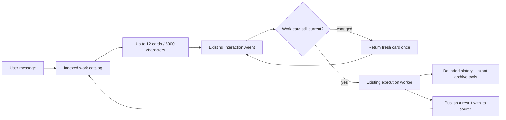

# OpenPoke 🌴

OpenPoke is a simplified, open-source take on [Interaction Company’s](https://interaction.co/about) [Poke](https://poke.com/) assistant—built to show how a multi-agent orchestration stack can feel genuinely useful. It keeps the handful of things Poke is great at (email triage, reminders, and persistent agents) while staying easy to spin up locally.

- Multi-agent FastAPI backend that mirrors Poke's interaction/execution split, powered by [OpenRouter](https://openrouter.ai/).
- Gmail tooling via [Composio](https://composio.dev/) for drafting/replying/forwarding without leaving chat.
- Trigger scheduler and background watchers for reminders and "important email" alerts.
- Next.js web UI that proxies everything through the shared `.env`, so plugging in API keys is the only setup.

## Continuation-aware discovery and bounded memory

The original sends every worker name to the Interaction Agent and loads an execution
worker's complete saved history. This fork keeps the existing agents and chat UI,
but changes what context they receive.



- **Build a shortlist:** exact worker names and observed object IDs first, up to
  three workers whose results were actually published next, then lexical search
  over names, instructions, and the latest result excerpt. Every card explains
  why it was included. The total candidate block is capped at 6,000 characters.
- **Check before dispatch:** code compares the selected card's version with
  stored state. If it changed, no work is dispatched; the IA gets one fresh card
  and can reconsider. A second stale attempt stops. A search miss can also use
  one bounded `find_agents` expansion.
- **Bound worker memory:** load at most 12,000 characters of recent archive
  context and 4,000 of compact state. Each tool response is capped at 6,000.
  Full new tool receipts remain in the existing logs; worker-bound archive tools
  retrieve older text using exact byte offsets and bounded literal search.

The contribution is using **published-result provenance and current work state**
to support continuations. If Alice's draft was shown and a hotel search completes
silently afterward, completion recency should not decide what “send it” means.
Publication is still evidence for the IA, not an automatic send instruction.
This is a concrete change to OpenPoke, not a claim of a new routing algorithm.
OpenPoke already reused worker code and started workers on demand.

The setup template enables `OPENPOKE_AGENT_DISCOVERY=focus`. `retrieval` removes
publication priority for comparison; `legacy` restores full-roster discovery.
All use the same execution runtime. No extra routing-model call, task migration,
or durable queue is required. See the [architecture and teaching guide](docs/agent-discovery.md)
for signals, recovery, tradeoffs, and source locations.

### What the measurements establish

On 15 hand-authored development cases, 12 require existing workers. At 100, 1,000,
and 10,000 stored workers, instruction-only lexical search included all required
workers in 6/12 cases; current-state lexical search did so in 9/12; adding
publication evidence reached 11/12. The remaining case deliberately uses a
paraphrase without matching vocabulary. Full-roster discovery includes 12/12
because it includes every worker.

These are **candidate inclusion results, not model routing accuracy**. The fixtures
provide correct publication annotations; they do not establish how reliably a live
model supplies them. At 10,000 workers, the observed maximum roster block fell from
483,936 to 5,668 characters. Indexed lookup itself was slower than constructing
the in-memory roster string in this local test; end-to-end latency and token savings
have not been measured. See [reproducible development evidence](docs/evidence/discovery-development.md).

At small roster sizes, richer cards can contain more text than the original names.
The 100,000-record stress probe also exposes costly broad searches; indexed lookup
does not mean constant-time search or production multi-user capacity.

### Limits

This remains a single-user application. It does not add tenant isolation, durable
job recovery, retention quotas, or a shared user-memory service. Broad lexical
queries can still do substantial database work. Worker names retain the original
filename-collision limitation. The compact result is an unverified excerpt, not
a complete semantic summary; old receipts that were truncated before saving
cannot be recovered. Observed draft/thread IDs do not establish ownership,
current provider state, or approval. Wrong-agent execution recovery and live
model/Gmail validation remain unfinished. The bounds above cover individual
context components, not total tokens across an entire run.
Synchronous provider calls run off the event loop, so other requests can progress.
A timeout or cancellation cannot stop a provider call already running in a thread;
its outcome may remain unknown, and this build does not automatically retry it.

## Requirements
- Python 3.10+
- Node.js 18+
- npm 9+

## Quickstart
1. **Clone and enter the repo.**
   ```bash
   git clone --branch codex/continuation-aware-discovery https://github.com/ammar-adam/openpoke.git
   cd openpoke
   ```
2. **Create a shared env file.** Copy the template and open it in your editor:
   ```bash
   cp .env.example .env
   ```
3. **Get your API keys and add them to `.env`:**
   
   **OpenRouter (Required)**
   - Create an account at [openrouter.ai](https://openrouter.ai/)
   - Generate an API key
   - Replace `your_openrouter_api_key_here` with your actual key in `.env`
   
   **Composio (Required for Gmail)**
   - Sign in at [composio.dev](https://composio.dev/)
   - Create an API key
   - Set up Gmail integration and get your auth config ID
   - Replace `your_composio_api_key_here` and `your_gmail_auth_config_id_here` in `.env`
4. **(Required) Create and activate a Python 3.10+ virtualenv:**
   ```bash
   # Ensure you're using Python 3.10+
   python3.10 -m venv .venv
   source .venv/bin/activate
   
   # Verify Python version (should show 3.10+)
   python --version
   ```
   On Windows (PowerShell):
   ```powershell
   # Use Python 3.10+ (adjust path as needed)
   python3.10 -m venv .venv
   .\.venv\Scripts\Activate.ps1
   
   # Verify Python version
   python --version
   ```

5. **Install backend dependencies:**
   ```bash
   pip install -r server/requirements.txt
   ```
6. **Install frontend dependencies:**
   ```bash
   npm install --prefix web
   ```
7. **Start the FastAPI server:**
   ```bash
   python -m server.server --reload
   ```
8. **Start the Next.js app (new terminal):**
   ```bash
   npm run dev --prefix web
   ```
9. **Connect Gmail for email workflows.** With both services running, open [http://localhost:3000](http://localhost:3000), head to *Settings → Gmail*, and complete the Composio OAuth flow. This step is required for email drafting, replies, and the important-email monitor.

The web app proxies API calls to the Python server using the values in `.env`, so keeping both processes running is required for end-to-end flows.

## Checks and evaluation

The final offline suite passes **113 tests**. Four existing FastAPI `on_event`
deprecation warnings remain. No live model or Gmail actions were used for validation.

```bash
pip install pytest
python -m pytest tests -q
python -m evals.routing.run --scales 100 1000 10000
```

The default evaluation uses synthetic data and makes no model or Gmail calls.
Its opt-in live mode still mocks worker execution and requires explicit call/cost
limits; see the teaching guide. The offline suite checks bounds, source attribution,
stale-state rejection, archive recovery, and callback handling.

## Project Layout
- `server/` – FastAPI application and agents
- `web/` – Next.js app
- `server/data/` – runtime data (ignored by git)

## License
MIT — see [LICENSE](LICENSE).
