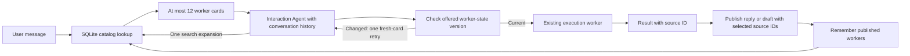
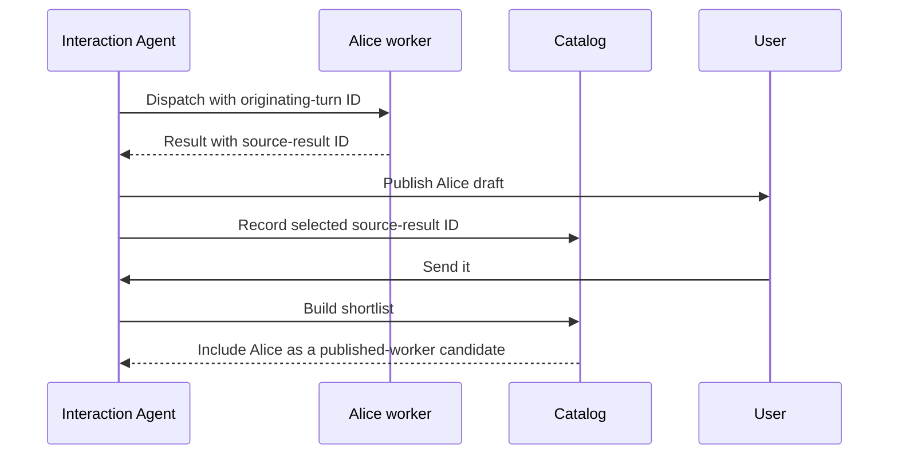

# Continuation-aware agent discovery

This prototype changes how the Interaction Agent finds existing workers. It keeps
the current chat interface, worker names, execution histories, and email tools.
Live model routing remains unmeasured. This version extends the existing execution
architecture; it adds no separate task runtime, durable job queue, or model router.

## Run it

Use Python 3.12 and install the server requirements plus pytest in a virtual environment.
Configure the application's existing integration credentials locally. Never put keys in
evaluation fixtures or commit them.

PowerShell:

```powershell
$env:OPENPOKE_AGENT_DISCOVERY = "focus"
.\.venv\Scripts\python.exe -m server.server
```

Modes are `legacy` (code fallback, full roster), `retrieval` (bounded search), and `focus`
(the same search with recently published worker references). Set `legacy` to
return to the original discovery behavior. The environment template selects `focus`.
Changing discovery mode does not delete the sidecar catalog. Bounded execution memory
is shared across modes.

## The architecture in plain language

An agent record is a saved worker identity, not a permanently running process.
Storing many records and putting them all into every model prompt are different costs.
This change keeps those records searchable and puts only a bounded set into the prompt.



Search decides which workers are considered. The Interaction Agent decides which
worker gets the request. The worker then chooses how to act. These are three
different places where a mistake can happen.

This version indexes **workers**, not individual tasks or email drafts. Selecting a
worker that contains two Alice drafts does not prove it will choose the right draft.
The original code already instantiated workers on demand and stored execution logs.
The change is which evidence enters the prompt, when stale evidence is rejected, and
how much history is read—not elimination of hundreds of resident model processes.

## How the shortlist is built

1. Preserve an exact worker-name match and indexed exact matches to observed draft,
   message, or thread IDs appearing in the query. IDs are matched literally, including
   common sentence-ending punctuation; this is not semantic object resolution.
2. For an eligible short user continuation, search the latest real user message
   separately and include up to three matches. These candidates are marked
   `recent_user_context`; they do not establish what the user approved.
3. In focus mode, include up to three distinct workers associated with recent published
   results. Their cards include the source result ID, kind, up to 200 characters of
   what the app showed, and the publication time.
4. Search worker names, the first recorded instruction, the latest instruction, and
   the last result excerpt using SQLite FTS5/BM25 with the English Porter stemmer.
   Deduplicate workers already included.
5. Fit at most 12 cards into a 6,000-character candidate block. Shorten metadata as
   needed, but never change a worker's name or version to make it fit.

BM25 ranks matching words using their frequency and document length. It is a useful
baseline for names and explicit topics, with no embedding service or extra model call.
Porter stemming lets terms such as `invoice` and `invoices` match. It is still lexical
search: it does not add synonyms or guarantee semantic paraphrase recall, and stemming
can also merge unrelated terms. Exact worker-name and observed-ID checks retain their
literal, case-sensitive behavior before lexical candidates. If SQLite lacks FTS5, the
SQL substring fallback still bounds returned rows but has no Porter stemming and can
scan metadata; it has weaker scaling.

The recent-user rule is an explicit, conservative English heuristic. The current
message must be at most 160 characters and 16 alphabetic words, use only the closed
continuation/editing vocabulary in `catalog.py`, and contain `it`, `that`, `this`,
`them`, `these`, `those`, `the same`, or a listed generic phrase such as `continue`,
`proceed`, `go ahead`, `carry on`, or `try again`. Optional acknowledgments and polite
words are allowed. Numbers, IDs, email addresses, apostrophes, unfamiliar words and
specific names such as Bob disable supplementation. Thus `make it shorter` can use
history, while `make it shorter for Bob` uses the current query only. This does not
recognize every possible name or distinguish all meanings of the allowed words.

Only the final 12,000 transcript characters are parsed as canonical XML records.
The query source is the last direct `user_message`, never an assistant reply,
background result or conversation summary. XML escaping is decoded once. A real
user message after a summary remains usable; a summary alone does not. Malformed or
truncated XML disables supplementation. If the last user message is itself a generic
continuation, the code does not hunt backward through older topics. The separate
history query uses at most 500 characters and 32 distinct terms, returning at most
three candidates inside the same 12-card/6,000-character budget. It is not a combined
all-history query or a semantic coreference system.

Specific current requests never receive these history candidates. The existing focus
mode can still include published workers, even on a topic switch. History candidates
only affect eligibility and order; the Interaction Agent still sees the conversation
and must decide whether to ask, answer, search further, or dispatch. Agent callbacks
never use this history heuristic and still require explicit source annotations for
publication. Runtime and lookup measurements call the same
`AgentCatalog.shortlist_for_turn` method; explicit `find_agents` remains available.

Recency breaks lexical ties. It does not decide meaning. Published workers receive
reserved consideration because follow-ups such as "send it" contain little searchable
text. They are clues, not an instruction to execute the newest result.

The numbers 12, three, and 6,000 are initial engineering settings. They have not been
optimized on held-out data. The enforced bound is in characters; actual model token
counts depend on the selected model. Conversation history and tool schemas are outside
this particular bound, and repeated model calls still incur their own input costs.

Each card and trace records why it entered: exact name, observed object reference,
recent user context, published reference, or lexical search. The initial trace also
records `history_retrieval` eligibility/reason and the tokenizer backend. Inspect
`runtime.last_discovery_trace` after a turn. Neither this trace nor candidate recall
proves which worker the model will select.

## Existing agents and new metadata

The catalog is a SQLite sidecar under `server/data/execution_agents/`. The existing
roster and execution logs remain compatible. A cheap roster fingerprint determines
whether legacy names need importing; unchanged turns do not parse the whole roster.
Legacy import reads names only, not every history file. First/latest instruction
metadata accumulates when the Interaction Agent dispatches workers in a bounded mode.
An explicitly dispatched scheduled worker can update its own row without scanning
the roster or every history.

Cards carry a monotonic version, latest run ID/status, and a last-result excerpt capped
at 768 characters. The excerpt is unverified worker prose, not a semantic summary or
proof that an action succeeded. Its separate `last_result_run_id` prevents a prior
result being attributed to a newer run that is still executing. `completed` describes
one run ending, not the user's goal being achieved. Late completion from an older run
cannot overwrite the latest run's state.

Up to eight object references per worker come from recognized successful Gmail receipt
shapes. Error payloads and prose do not create references. The same object may have
been observed by multiple workers; these are retrieval hints, not exclusive ownership,
fresh provider state, or user approval. Older references can fall out of this bounded
index while remaining in execution logs. Existing database files receive additive
columns when needed. The FTS index has a separate schema version,
`2-porter-unicode61`: opening an unversioned or older index transactionally recreates
its triggers/index and rebuilds it from the existing agent rows. The version is saved
only after success; a failed migration rolls back the derived-index changes. Names,
instructions, versions, object references, publications and execution logs are not
rewritten. Reopening a current index does not rebuild it again. The first upgrade
therefore has a one-time indexing cost; ordinary shortlist requests do not rebuild
or scan all worker histories.

This means older workers initially have weaker search metadata. The evaluation
explicitly separates names-only import from enriched records. Renaming workers,
repairing historical filename collisions, and migrating identities are outside this change.

## Why publication references matter

Suppose Alice's draft is shown, then a hotel worker completes silently, then the user
says "send it." Completion order does not establish what "it" refers to.



The batch manager carries originating-turn and result IDs through asynchronous
execution. Results from unrelated bounded-mode turns are kept in separate batches.
When publishing, the model may supply `source_result_ids`; code checks that each ID
belongs to the current callback before publishing. Unshown completions do not enter focus.

Missing annotations leave a reply visible but do not promote a worker. Direct final
assistant text also lacks an explicit source annotation. Those are coverage gaps,
not proof of correct automatic attribution. Membership validation proves that a
referenced worker supplied a current result; it does not prove the draft text matches
a provider-stored artifact or that the user approved it. Existing confirmation behavior
remains in place; this feature is not an approval-security implementation.

## What happens when discovery is wrong

The Interaction Agent can call `find_agents` once per turn, using concrete context or
an exact worker name. Code bounds the returned tool message and rejects further
expansions. An empty result is not treated as proof that new work is needed.

In bounded modes, creating an unknown worker requires the explicit boolean
`create_if_missing=true`. A misspelled existing name no longer silently creates a
worker by default. A new task involving Alice can still deserve a separate worker;
sharing a person does not automatically merge work.

This recovery occurs **before dispatch**. A confidently incorrect choice of an existing
worker can still happen. There is no worker-level NOT_MINE protocol, durable job queue,
or new side-effect retry system in this focused prototype.

The version on an offered card is checked atomically when dispatch metadata is saved.
If a worker has since started, produced new object evidence, or finished, the old
version is rejected without dispatch writes. The IA gets one fresh card and can
reconsider. A second conflict does not silently execute. This prevents using an
already-stale snapshot at dispatch; it does not lock a worker for the whole execution,
make effects exactly-once, or prove the chosen worker matches the user's intent.
Synchronous provider calls run in a thread so the event loop remains responsive.
Cancelling a run cannot stop an already-running provider call; its remote outcome may
be unknown. The system does not automatically retry that external action.

A successful Interaction Agent `wait` now ends the current model loop after every
tool call in that response has been processed. A dispatch or publication following
`wait` in the same batch is preserved. Explicit user messages and logged drafts stay
visible; fallback assistant prose is suppressed because `wait` is a silent yield.
A failed wait can be corrected on the next model call. Pending execution workers
are not cancelled, and their later callbacks run as normal new interaction turns.
This fixes repeated wait calls exhausting the eight-iteration cap.

## Bounded worker memory, with access to the original log

The existing executor reads a recent XML log tail into an envelope capped at 12,000
serialized JSON characters, reading at most 48,000 bytes, plus at most 4,000 characters
of compact catalog state. The base prompt and current request are separate. No new
model summary is generated. Older constraints can therefore be absent from the
initial prompt; the worker can retrieve source evidence when needed.

New tool receipts are stored with exact JSON escaping before their model-facing view
is capped at 6,000 characters. `read_worker_archive(offset=0, limit=3000)` reads by byte
cursor, with a maximum 4,000-byte chunk plus up to three bytes to finish a UTF-8
character. Its envelope is capped at 5,000 serialized characters. Follow `next_offset`
until null; concatenate the raw XML/JSON text before decoding escaped contents.

`search_worker_archive(query, offset=0)` performs literal, case-sensitive search with a
1–200-character query. Each call reads at most 65,536 bytes plus query-overlap bytes,
returns at most five matches in a 5,000-character envelope, and provides `next_offset`
when more remains. An empty intermediate page does not prove absence. This is bounded
paging, not a full-history scan hidden inside each request or a semantic search index.

Exact retrieval means returning what was stored. It does not make a worker's claim
true, prove a remote action succeeded, recover data truncated by the old logger before
storage, or repair historical filename collisions.

## Tests and evaluation

Run deterministic tests:

```powershell
.\.venv\Scripts\python.exe -m pytest tests -q
```

Some Windows sandboxes block the local socket pair used to initialize asyncio.
If tests hang there before application code, run the offline tests in an environment
that permits local loopback. The tests mock model calls and external actions.

Run offline lookup measurements:

```powershell
.\.venv\Scripts\python.exe -m evals.routing.run --scales 100 1000 10000
```

The command writes JSONL records, a manifest, and a summary under
`evals/routing/results/`. It compares nested populations with fixed target workers
and histories. It measures initial candidate recall, rendered characters, and lookup
latency. Keeping the target in the shortlist is not the same as selecting it correctly.

The fifteen hand-authored cases are development scenarios, not a held-out benchmark.
Publication fixtures are preseeded with correct references; the lookup results do not
measure how reliably a live model supplies publication annotations. Separate runtime
tests check validation, omission behavior, asynchronous callbacks, and reset handling.

For opt-in live routing, add `--live`, a model, verified effective input/output prices
per million tokens, `--max-estimated-usd`, and `--max-calls`. An OpenRouter key must be
configured. Output tokens are capped per call. The cost ceiling uses declared prices
and a conservative input-size estimate; it is not a provider billing guarantee.
Actual usage is recorded when the provider returns it. Missing usage means unavailable.

Even live evaluation mocks every worker execution: it measures the Interaction
Agent's routing turn, not whether an email is correctly sent. It records every
dispatch, duplicate, search expansion, response, and model call. Clarifications and
direct answers require manual review; an empty output is never automatically counted
as a correct clarification.

The baseline prompt and tool schemas are pinned to commit
`5b5f635935a64ab37884c025d70abb0ed731c094`. Bounded and focus variants share metadata.
Comparing baseline with bounded discovery measures the whole feature, including
richer metadata; comparing bounded with focus isolates the added publication signal.
All three modes also share the wait-yield runtime correction above. Therefore these
comparisons preserve the baseline prompt/schema but do not run its original broken
wait-loop behavior. Keep pre-fix and post-fix live runs separate and retain their
source digests; do not silently pool earlier iteration-limit failures with later runs.

## Tradeoffs and limits to explain

| Choice | Benefit | Cost or limitation |
|---|---|---|
| SQLite sidecar | Simple persistence and indexed lookup | Single-user prototype; no authentication or distributed capacity proof |
| Lexical search first | Understandable signals, no extra model call | Can miss paraphrases and weak legacy descriptions |
| Existing Interaction Agent chooses | Preserves orchestration and avoids a new routing-model dependency | Selection quality still needs live evaluation |
| Published-worker candidates | Helps resolve short continuations | Depends on valid, relevant publication annotations |
| Explicit creation flag | Makes accidental creation harder | The model still decides when work is genuinely new |
| One search expansion | Bounds additional discovery work | May stop before a difficult reference is resolved |
| Versioned worker cards | Reject already-stale dispatch context | Does not serialize whole runs or establish user intent |
| Bounded worker history plus archive tools | Limits initial reads while retaining source access | Retrieval may require more calls; old missing evidence cannot be restored |
| Existing names/history retained | Small, compatible integration | Historical collisions and growing disk archives remain |

Semantic history compaction, task checkpoints, authenticated multi-user operation,
durable acceptance, shared execution budgets, and provider outcome reconciliation
remain outside this implementation. Do not use an offline 10,000-record lookup result
as evidence that all of those problems have been solved. Disk retention is unbounded,
the global conversation/account configuration is still single-user, and aggregate
tool-loop tokens and concurrent external work do not have a new global budget.

## Teaching checkpoints

The teacher/coordinator should use actual traces to discuss these questions:

1. Why can storing 10,000 records be reasonable while placing 10,000 names in a prompt is costly?
2. If the right worker is absent from the shortlist, which stage failed?
3. If it is present but the wrong worker is dispatched, which stage failed?
4. Why does a background completion not establish what the user meant by "it"?
5. What does `source_result_ids` validation prove, and what does it leave unverified?
6. Which costs are bounded here, and which can still grow?
7. What did the offline evaluation measure, and what evidence requires live calls?

Use planned, implemented, tested, and unverified as separate status labels. A passing
scripted test verifies a code path; it does not establish model quality.

A useful teach-back is: "Search makes a small candidate set; the IA chooses a worker;
the existing worker performs the action. A record is not a resident model. A version
checks freshness, not correctness. A receipt ID is an observed reference, not approval.
An exact archive read preserves stored text, not the truth of that text. Bounded
prompts do not imply bounded disk storage or production multi-user scalability."
