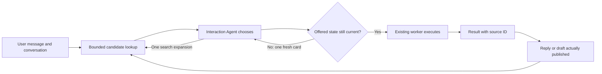

# Explaining and defending the discovery change

Use this as speaker notes, not a claim that the system is production-ready.
The implementation detail is in [the guide](agent-discovery.md). The
[live evidence report](evidence/live-routing.md) records measured runs and limitations.
Use [slides 5–9 and speaker notes](slides-and-speaker-notes.md) for copy-ready bullets.

## The problem and the claim

“The original system gives the Interaction Agent every worker name on every turn.
That makes prompt size grow with saved work, even when the user is continuing one
email. I keep the existing execution architecture and give the Interaction Agent
a small, explainable set of candidates with evidence about the current work.”

A worker record is not a permanently running model. The original implementation
already created execution runtimes on demand. This change does not eliminate
thousands of resident agents; it reduces prompt attention and initial history reads.
Storing 1,000 indexed records is different from presenting 1,000 candidates to a
model. There is still a database query, and broad queries can still get slower as
the catalog grows. We have not proved that database storage was the original
bottleneck or that the application supports concurrent tenants.

## Explain the four pieces

| Piece | Why it exists | What it does not establish |
|---|---|---|
| Indexed shortlist | Keep likely existing workers available without loading the full roster into the prompt | That the correct worker was retrieved or selected |
| Published-result evidence | Distinguish work shown to the user from work that merely completed | That displayed content is accurate, that the user read it, or that an action is approved |
| Worker-state version check | Reject a dispatch based on a card that changed after the model read it | That the selected worker is appropriate, or that its eventual action is safe |
| Bounded worker memory with archive access | Limit initial history reads while allowing retrieval of older stored evidence | That all important constraints fit in the initial prompt, or that stored claims are true |

The shortlist starts with exact worker-name and observed object-ID matches. For a
conservative short-continuation pattern, it can also retrieve from the latest
direct user message. Focus mode preserves up to three recently published workers.
Lexical search fills the remaining places; duplicates are removed. The final block
has at most 12 cards and 6,000 characters. These are engineering defaults, not
experimentally optimal numbers or token guarantees.

BM25 ranks matching words using word frequency and document length. Porter stemming
helps forms such as “invoice” and “invoices” match. Neither supplies synonyms or
understands intent. Recency breaks lexical ties; it is not a substitute for meaning.
Observed draft/message/thread IDs come from recognized successful tool receipts,
but remain retrieval hints rather than exclusive object ownership.

The worker initially receives a recent-log envelope capped at 12,000 serialized
characters and compact catalog state capped at 4,000. Older evidence remains
available through bounded archive reads and literal search. There is no semantic
summary pretending to remember everything. Prompt, request, and subsequent tool
calls have additional costs; disk archives and total loop cost can still grow.

## Walk through one example

Alice's email draft is shown. A hotel comparison completes silently. The user says
“send it.” A most-recent-completion rule would favor hotels. Instead, source IDs
attached to the actual publication make Alice's worker a candidate. The Interaction
Agent still reads the conversation and decides whether to continue, ask, or search.
No code automatically sends the latest published draft.

If Alice's worker changes while the Interaction Agent is thinking, dispatch rejects
the stale version without queueing work. The model gets one fresh card to reconsider.
A second conflict is refused. This is a freshness check, not a lock over the whole
run or an approval mechanism for a particular email body.

If the right worker is missing, one bounded `find_agents` expansion is available.
If the model still chooses a wrong existing worker, this version has no automatic
worker-level “not mine” recovery. Unknown workers require an explicit creation flag;
that reduces accidental creation but does not prove the new work is necessary.

## Why not the simpler alternatives?

| Alternative | What it helps | Why it is insufficient alone |
|---|---|---|
| Archive dormant workers | Reduces active clutter and can support retention | Old work may become relevant; age does not identify the current referent |
| Keep only recent workers | Cheap and useful for repeated activity | A silent background completion can displace the draft the user is discussing |
| Semantic search alone | Can recover paraphrases with little word overlap | Similarity does not establish what was shown, current state, or approval; embeddings need updating and evaluation |
| Add a separate model router | Could improve selection or reduce later context | Adds another request and failure mode; cannot select a missing candidate; a confident score is not a correctness guarantee |
| Group everything by person | Reduces visible worker count | Alice's budget, lease, and birthday are different work with different state |

These are possible additions, not inherently bad ideas. First measure which stage
fails. Semantic retrieval is relevant when the right worker is missing. A router
needs evidence of better selection when the right worker is already available.
Neither replaces publication evidence or freshness checks. This uses established
mechanisms; the contribution is the narrow integration and its measurable behavior,
not a novel ranking algorithm.

## Explain the evidence precisely

| Evidence | What it can support | What it cannot support |
|---|---|---|
| Scripted unit/integration tests | Bounds, stale-state rejection, accounting, source validation, and actual runtime control flow | Model judgment or useful natural-language responses |
| Offline synthetic catalog measurements | Candidate inclusion, rendered characters, local lookup time and storage for those fixtures | Correct model choice, concurrent load, or real user accuracy |
| Live models on synthetic scenarios | Actual model selection and response behavior under the recorded prompts and fixtures | Representative production quality or successful Gmail execution |
| Real Gmail integration testing | Provider behavior and state changes checked against a controlled account | Broad routing quality or multi-user scalability by itself |

There are **15 authored regression cases and 40 further authored cases**: 20 challenge
cases plus 20 additional scenarios. “Fresh” means newly written; authors know the implementation. The smoke and
validation groups organize the workflow and are not independent statistical
holdouts. Recorded live results are mixed. The challenge callback cases run the real
Interaction Agent callback and follow-up with a shared conversation and catalog;
publication evidence must be generated through the real tools, not preseeded as
correct. Worker executions are mocked, so these runs send no Gmail messages.

Candidate inclusion, final worker dispatches, source annotations, and visible
content are separate measurements. A correct worker ID can carry wrong instructions.
Valid source IDs can accompany the wrong draft text. Clarifications, direct answers,
and published content need explicit review; an empty response is not success.
Repeated trials remain grouped by scenario. Budget-exhausted or transport-failed
trials are marked unrun/incomplete/operational failures, not wrong routing answers.

## Answers to the hard questions

**“Fifteen cases isn't enough.”**

“Correct. They are regression examples for specific failure mechanisms, not a
population accuracy estimate. We added 40 authored cases and repeated live
trials, but neither makes them representative. I can defend the bounds and the
behavior on these recorded cases. A broader quality claim needs representative,
de-identified conversations, independent labels, and evaluation after the choices
and thresholds have been frozen.”

**“Why no real testing?”**

“There are real-runtime tests and live model tests on synthetic scenarios; there
is no claim of end-to-end Gmail validation. Mocked execution isolates the routing
decision and lets us compare the same scenario safely across variants. The next
integration test needs a controlled account with known drafts, revisions, and
messages, then assertions against provider state after each action. That measures
a different part of the system, and it is still unfinished.”

**“Does this solve scalability?”**

“It bounds candidate prompt size and initial worker-memory reads. It does not add
authenticated tenant isolation, durable execution acceptance, distributed workers,
archive retention, or a global execution budget. The application still has
single-user conversation/account state. A large synthetic catalog is evidence about
catalog lookup, not proof of a production multi-user service.”

**“What would make you change the design?”**

“If candidate misses dominate, improve retrieval and evaluate its added cost. If
selection fails despite good candidates, improve the Interaction Agent context or
compare a separate router. If retrieved history repeatedly misses constraints,
improve memory retrieval. Use the traces to locate the failure before adding a new
component.”
