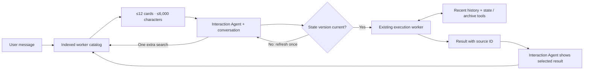

# Slides 5–9: the decision, implementation, and evidence

Use only the bullets under **On the slide** in the deck. The explanation below each
slide is for speaking and answering questions. See the [recorded evaluation](evidence/live-routing.md)
for final run counts and reviewed outcomes; do not describe repeated attempts as
different user requests.

## Slide 5 — What do we do instead?

**On the slide**

- Keep all workers searchable; show the model at most **12 candidate cards**.
- Track **what the user was shown**, so “send it” has a useful reference.
- Load recent worker history and current state; fetch older details when needed.
- Keep the existing Interaction Agent choosing: no extra routing-model call.

**Say this**

“I split the problem into finding candidates, choosing one, and executing with the
right context. The model needs enough evidence to make a decision. It does not need
every saved worker in every prompt. A database index finds candidates first. The
existing Interaction Agent still has the conversation and makes the choice.”

“Search alone has a hole: ‘send it’ contains no topic to search. I therefore keep
references to results actually shown to the user. A silent background completion
does not replace the thing we were discussing. These references make a worker a
candidate; they do not authorize sending anything.”

**Why these choices, rather than the alternatives?**

| Alternative | Why I did not make it the main solution | When I would reconsider |
|---|---|---|
| Archive old workers | Age is not relevance. An old lease can become relevant today. Archiving also does not identify what “it” means. | Add retention separately when disk growth becomes a problem. |
| Use only the most recently active workers | Background activity can be more recent than the draft the user saw. | Recency is useful as a tie-breaker, not the main decision rule. |
| Start with semantic search | It helps paraphrases, but similarity alone does not identify the published draft or its latest state. Lexical search provides a small, inspectable baseline with no embedding service. | Add it if measured candidate misses justify the extra index and maintenance. Our paraphrase miss is a concrete reason to investigate it. |
| Add a Decisions API or another model router | It adds a request, needs conversation context, and cannot choose a worker absent from the shortlist. A returned probability would still need calibration. | Compare it when the correct worker is retrieved but selection remains wrong. We have not established its latency or quality benefit. |
| Add a memory agent or a background summarizer | A model-written summary can omit exact IDs or constraints. Updating bounded state on real events is simpler and fresher for this prototype. | Consider semantic summaries after measuring which historical details workers fail to retrieve. |
| Group all email work, or all work for Alice | That reduces labels without resolving Alice's separate lease, budget, and birthday state. | Broader capabilities can help tool organization; individual work still needs distinct state. |

**The tradeoff:** a bounded shortlist can omit the right worker. That is why we
measure candidate inclusion and allow one additional search. We did not prove
SQLite lookup is faster than building a roster string; we reduced what the model
has to read.

## Slide 6 — Architecture guide

**On the slide**

- **Catalog:** exact names/IDs, recent conversation, published work, then word matches.
- **Interaction Agent:** chooses from the shortlist; can search once more if needed.
- **Dispatch:** reject a changed state version; return a fresh card once.
- **Worker:** recent history + current state + tools to retrieve older log details.

**Diagram**

**Say this**

“The catalog is a SQLite sidecar, not another agent. It holds a worker's name,
instructions, latest run status, a short result excerpt, observed object IDs, and a
version number. Dispatch and completion update it directly. I do not run a cron
job to guess whether it changed.”

“Candidate order is deliberate. An exact worker name or observed draft/thread ID
is specific evidence. For a short generic continuation such as ‘make it shorter,’
a conservative English rule can search the latest actual user request and add up
to three candidates. Then focus mode adds up to three workers whose results were
published. Word search fills the remaining space. We remove duplicates and enforce
12 cards and 6,000 characters total.”

“Word search uses SQLite FTS5 with BM25. BM25 ranks matching words using frequency
and document length. Stemming lets ‘invoice’ match ‘invoices’; it does not understand
synonyms. Names and exact object IDs retain literal matching. Every candidate
records which signal included it, so I can inspect a bad shortlist.”

“A version check catches state changing between reading a card and dispatching.
It does not prove the user's intent, lock the entire run, or approve an email body.”

**Memory in plain language:** the initial worker prompt contains at most 12,000
characters of recent log context and 4,000 of compact state. The prompt and current
request are additional. Full new receipts are saved before the model-facing view
is shortened. The worker can page through its own archive or search literal text.
This bounds initial reading, not total disk storage or every token in a run. The
result excerpt is unverified prose, not a complete summary.

**If asked about 100 users × 1,000 workers:** “100,000 saved records are a database
storage problem. Sending all of them to a model is a separate attention problem.
An index avoids loading every history to build a shortlist, although broad searches
can still be expensive. This fork remains single-user; a large catalog test does
not prove tenant isolation or concurrent capacity.”

## Slide 7 — How this works in practice

**On the slide**

- Alice's draft is shown; a hotel search finishes silently afterward.
- The user says **“send it”**: Alice stays a candidate because her draft was shown.
- The Interaction Agent uses the conversation; missing context permits one search.
- If Alice's state changed, refresh before dispatch. Publication alone is not approval.

**Say this**

“Most recent completion would favor the hotel worker. My publication reference
points back to Alice's actual result instead. The model can still see other relevant
candidates and the conversation; the code does not blindly pick Alice.”

“If the right worker is absent, `find_agents` allows one bounded search. Creating
an unknown worker requires `create_if_missing=true`, so a misspelled name does not
silently create a duplicate by default. If the model confidently chooses the wrong
existing worker, however, there is no automatic ‘not mine’ handback yet.”

“When a worker finishes, it returns a source-result ID. Publication tools accept
only source IDs belonging to that callback. That stops an arbitrary reference
being recorded as current evidence. It does not check that every word in the
displayed draft matches the stored provider draft.”

“The live runs exposed a separate issue: refreshing changed state does not prevent
the model from inventing approval. Binding approval to the exact draft version is
unfinished. I would not describe this feature as a safe-send gate.”

## Slide 8 — How this was tested

**On the slide**

- **243 automated tests** check limits, stale state, memory, and callbacks.
- **40 authored scenarios** with live models: full roster vs search vs search + published context.
- Main comparison: **76.2% less input**, but correct worker **25/30 vs 28/30**.
- One actual-worker demo passed with simulated Gmail; real Gmail and human validation remain untested.

**Say this**

“The original 15 cases are regression examples. We added 20 challenge cases and
20 further authored cases. The main comparison repeats 14 challenge scenarios
three times across three modes: 126 attempts, not 126 distinct requests. Authors
knew the implementation, so this is not an independent holdout.”

“Each mode in the main comparison uses the same runtime and selected model. The baseline
prompt and tool schemas are pinned. Comparing the baseline with retrieval measures
the complete change, including richer worker metadata. Comparing retrieval with
focus isolates the added publication signal.”

“I separate the stages. Did search include every required worker? Did the model
dispatch the expected workers? Were their instructions actually correct? Was the
draft or answer shown to the user correct? The right worker ID can still carry
the wrong instruction. Valid source metadata can still accompany wrong text.”

“Deterministic tests check bounds, version conflicts, archive access, and callbacks.
Live routing tests use real model calls but mock worker execution. The separate
execution demo runs the actual workers and callbacks against simulated Gmail.
Its recorded run passed all 12 integration checks; the draft was displayed twice,
so conversational polish remains imperfect. None of that establishes real
Gmail/Composio behavior or reliability across other tasks.”

“Content reviews are model-assisted, with uncertain judgments left unscored and
original reviews retained. They are not human ground truth. Provider errors and
unrun trials are reported separately. Pacing was added to avoid rate limits, so
elapsed times cannot support a production speedup claim.”

**Measured example:** in the 1,000-worker, 14-case Luna comparison, focus used
817,914 input tokens across its repeated attempts versus 3,439,273 for the full
roster—about 76% fewer. That is total recorded input over those runs, not a
guaranteed saving for every request. Automatic dispatch identity was 25/30 versus
28/30 under the strict fixture labels; one fixture's requested operation was
ambiguous. These results support reduced input, not an overall quality win.
Use the [evidence report](evidence/live-routing.md) for reviewed results and all
other cohorts, including failures.

A later fix makes `wait` yield only when its entire tool batch succeeded, allowing
recovery from a failed dispatch first. The main token comparison predates that fix;
subsequent confirmation runs are separate evidence, not a silent replacement of
the original results.

## Slide 9 — What we still can do

**On the slide**

- Bind approval to the exact draft and version; verify the provider's actual result.
- Add semantic retrieval if paraphrase misses justify it; add a router only if selection improves.
- Test independent real conversations and a controlled Gmail account, with human review.
- Add tenant isolation, retention, and durable recovery before claiming production scale.

**Say this**

“The next work follows the observed failure, not whichever component sounds most
advanced. A missing candidate is a retrieval failure. A wrong choice with the right
candidate present is a selection failure. A correct choice with an incorrect send
is an execution or approval failure. Those require different fixes.”

“Memory remains incomplete: the log tail can omit an old constraint, and the model
may not retrieve it. The archive is exact stored text, not a truth guarantee. I
would add long-history tasks that require old constraints before choosing a
semantic summary or shared memory service.”

“The runtimes have iteration limits, and the wait-loop bug is fixed: wait yields
when the whole tool batch succeeds; a failed dispatch gets recovery first.
That still does not give us durable recovery or
automatic wrong-worker handback. Cancelling a thread cannot retract a provider
request already in progress. Retrying it without checking the outcome could create
duplicate effects.”

“The defensible result today is bounded context, inspectable retrieval, and recorded
evidence about where it succeeds and fails. I have not proved that the complete
system is better or production-ready.”

## Code map for questions

| If someone asks… | Start here |
|---|---|
| How is a candidate included? | `server/services/execution/catalog.py`: `shortlist_for_turn`, `shortlist`, `search`, `continuation_history_query` |
| Where are bounds and additional search enforced? | `server/agents/interaction_agent/runtime.py`: `_prepare_messages`, `_find_agents` |
| Where are stale cards rejected? | `server/services/execution/catalog.py`: `record_dispatch`, plus the dispatch tool's offered-version check |
| What does the worker remember? | `server/agents/execution_agent/agent.py`: prompt construction and receipt storage; its archive tools read the original log |
| Why does wait no longer spin? | `server/agents/interaction_agent/runtime.py`: process every tool call, then yield on `wait` only if the whole batch succeeded; allow recovery from failed calls first |
| What exactly was evaluated? | `evals/routing/run.py`, `harness.py`, `reporting.py`, and the frozen fixtures/manifests linked in the evidence report |
| Did a real worker execute? | `evals/execution_demo.py`: actual worker/batch runtime, explicitly simulated Gmail boundary |
